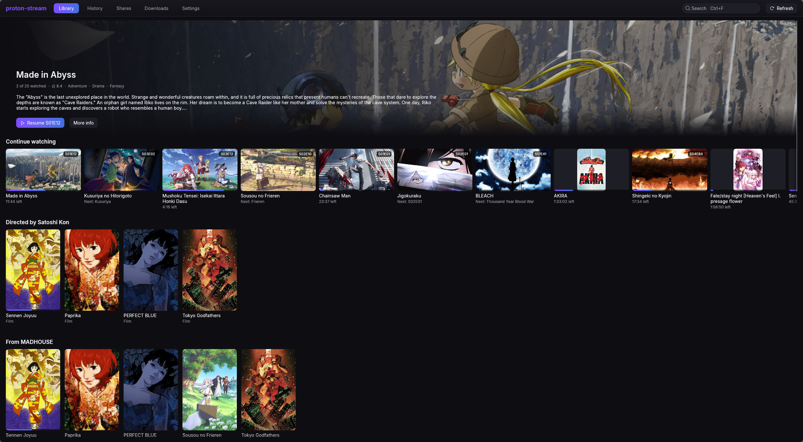

<div align="center">


# proton-stream

**Your Proton Drive, streaming.** A Netflix-style library for the videos in your Proton Drive and
the share links people send you, on Linux, Windows, Android, Android TV and iOS.

**[proton-stream.narl.io](https://proton-stream.narl.io)**

[](https://github.com/narrrl/proton-stream/actions/workflows/ci.yml)
[](https://github.com/narrrl/proton-stream/releases/latest)
[](#license)
[](https://www.rust-lang.org)
[](https://buymeacoffee.com/narl)



</div>

> [!IMPORTANT]
> This is an **unofficial**, community-built client. It is not affiliated with, endorsed by, or
> supported by Proton AG. "Proton" and "Proton Drive" are trademarks of Proton AG, used here only
> to describe what the software talks to. It provides no content: it plays what you keep in
> Proton Drive or what is shared with you.

## Features

**Library**

- **Public share links or your own Drive.** Paste a share link, with its password if it has one,
  or sign in and pick folders of your Drive. Any number of them merge into one library.
- **Seasons and episodes from your folders.** The folder names the show, the file name gives the
  season and episode, and a file without numbers is a film.
- **Posters, synopses and shelves**, from AniList or TMDB, **off by default**: shelves such as
  *Directed by* and *From MADHOUSE*, a franchise folded into one tile, and a hand-picked match
  that is never overwritten.
- **Filters and sorting:** series, films, watching, not started, downloaded; by name, last watched,
  last added, air date, rating or popularity.

**Player**

- **Streams, never downloads first.** Episodes start in seconds, and a seek fetches only what it
  lands on.
- **libmpv inside the app's own window:** HEVC 10-bit, HDR and ASS subtitles with hardware
  decoding, and no transcoding.
- **Skip the opening and the ending** by chapter, an **Up next** countdown, and next and previous
  episode.
- **Subtitle files beside the video** (`.srt`, `.ass`, `.ssa`, `.vtt`), and **the dialogue track
  over *Signs & Songs***. Audio and subtitle choices are remembered for each show.

**Everywhere**

- **Resume on any device.** Sign in, and your place in every episode, your shares and your
  settings sync through your own Drive.
- **Downloads** of an episode, a season or a show, to play offline.
- **Android 12+ and Android TV** with Material 3, background audio and new-episode
  notifications; **iOS 17+** as a SwiftUI port for SideStore and AltStore.
- **Themes:** a near-black default, four Catppuccin flavours and Persona 5, each with nine accents.
- **Full keyboard control** on the desktop, and the `pstr` command line.

<table>
  <tr>
    <td width="50%"></td>
    <td width="50%">
      
      
      
      
    </td>
  </tr>
</table>

## Install

Every [release](https://github.com/narrrl/proton-stream/releases/latest) has:

| Platform | Download |
|---|---|
| Debian, Ubuntu | `proton-stream_<version>-1_amd64.deb` |
| Fedora | `proton-stream-<version>-1.x86_64.rpm` |
| Other Linux | `proton-stream-<version>-x86_64-unknown-linux-gnu.tar.gz` |
| Windows | `proton-stream-<version>-x64.msi`, or the portable `…-x86_64-windows.zip` |
| Android, Android TV | `proton-stream-<version>-android.apk` |
| iOS, iPadOS | `proton-stream-<version>-ios.ipa`, for SideStore or AltStore |

```bash
sudo apt install ./proton-stream_*_amd64.deb     # Debian, Ubuntu
sudo dnf install ./proton-stream-*.x86_64.rpm    # Fedora
cd packaging && makepkg -si                      # Arch, from a checkout
```

Then open **Proton Stream**, paste a share link on the **Shares** page (or press **Ctrl+V**), and
the library fills in. [Getting started](docs/GETTING_STARTED.md) walks through it, and
[Installation](docs/INSTALL.md) covers every platform, updating and uninstalling.

## Documentation

The [wiki](https://github.com/narrrl/proton-stream/wiki) is generated from [`docs/`](docs/) on
every push to `main`:

- [Getting started](docs/GETTING_STARTED.md), [Installation](docs/INSTALL.md) and the
  [FAQ](docs/FAQ.md)
- [User guide](docs/USER_GUIDE.md), [Account and sync](docs/ACCOUNT_AND_SYNC.md) and
  [Android and iOS](docs/MOBILE.md)
- [Command-line reference](docs/CLI.md), [Privacy](docs/PRIVACY.md) and
  [Troubleshooting](docs/TROUBLESHOOTING.md)
- For contributors: [Development](docs/DEVELOPMENT.md), [Architecture](docs/ARCHITECTURE.md),
  [Testing](docs/TESTING.md), [Android](docs/ANDROID.md) and [iOS](docs/IOS.md)

## Why it works

A Proton Drive file's content blocks are each a self-contained PGP packet decrypted under one
shared session key. There is no sequential streaming session to resume, so seeking costs exactly
the blocks the seek lands on: a 2 GB episode plays without downloading 2 GB of it.

On a 761 MiB, 26-minute 1080p HEVC episode over a real password-protected link: **2.3 s to first
frame, about 1.5 s to resume after dragging to an arbitrary point, and 61 MiB fetched for the
first 38 seconds of playback.** Watch it again and the disk cache serves it with **no network at
all**: 0.3 s to first frame.

The player is fed through an in-process mpv stream callback, not a local HTTP server, so there is
no port another process could ask for the plaintext. [Architecture](docs/ARCHITECTURE.md) has the
whole data flow.

Built on [`proton-sdk-rs`](https://github.com/narrrl/proton-sdk-rs), a pure-Rust Proton Drive
SDK.

## Privacy

- **No server, no telemetry.** Each app talks to Proton and to nothing else, unless you turn on
  posters and descriptions, which sends your title names to AniList or TMDB.
- **The part of a share link after `#` is its decryption key.** It, any link password and your
  Proton session live in the system credential store (Secret Service, Credential Manager, the
  Android Keystore, the iOS Keychain), never in a config file.
- **Sync is end-to-end encrypted.** Watch history, shares and settings travel through your own
  Drive, one file per device.
- **The block cache and downloads hold decrypted video** in your cache and data folders. Size or
  empty the cache in **Settings → Storage**.

[Privacy](docs/PRIVACY.md) lists every connection and every file.

## Building

Rust 2024, MSRV 1.96.

```bash
cargo build --release
cargo run --release -p pstr-app                    # the app
cargo run -p pstr-cli -- add --name anime 'URL'    # the same work, headless
```

`pstr-player` needs libmpv development headers (`mpv` ≥ 2.0), and on Linux `pstr-app` needs
WebKitGTK 4.1's, for the CAPTCHA window. The Proton SDK crates come from crates.io.

- **Release artifacts:** `scripts/build.sh` (tarball, `.deb`, `.rpm`, Arch, macOS) and
  `scripts/build-windows.sh` or `scripts\build.ps1` (`.zip`, `.msi`). See
  [`packaging/README.md`](packaging/README.md).
- **Android:** JDK 17, Android SDK 36, NDK 28, `cargo-ndk`, then
  `scripts/build-android.sh debug`. See [`docs/ANDROID.md`](docs/ANDROID.md).
- **iOS:** macOS with Xcode and XcodeGen, then `scripts/build-ios.sh all`. See
  [`docs/IOS.md`](docs/IOS.md).

## License

The shared Rust crates and desktop application are MIT licensed. The Android and iOS applications
and their combined native distributions are GPL-3.0-or-later; see
[`android/LICENSE.md`](android/LICENSE.md), [`ios/LICENSE.md`](ios/LICENSE.md) and the bundled
component notices. The desktop application embeds the Inter typeface, under the SIL Open Font
License 1.1 ([`crates/pstr-app/assets/fonts/Inter-OFL.txt`](crates/pstr-app/assets/fonts/Inter-OFL.txt)),
and the Phosphor icon font, under MIT.
