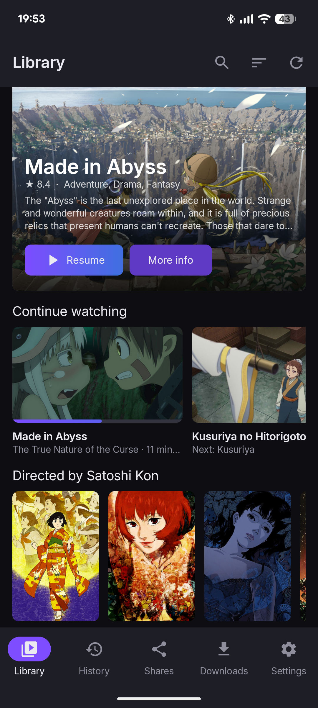
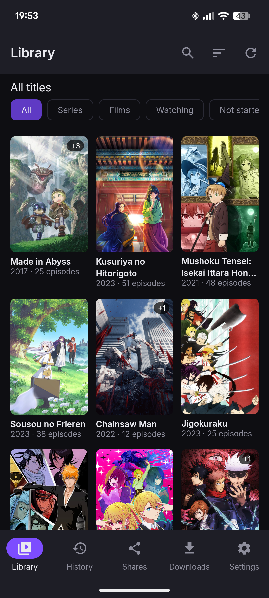
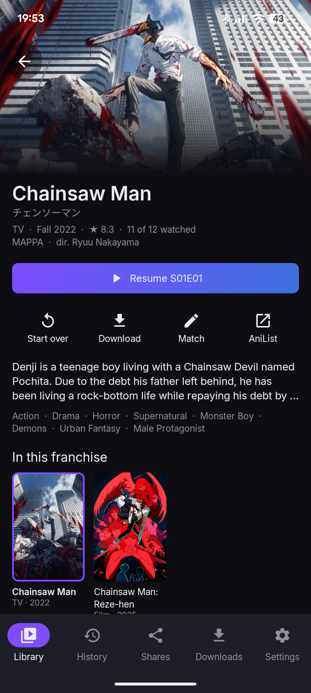
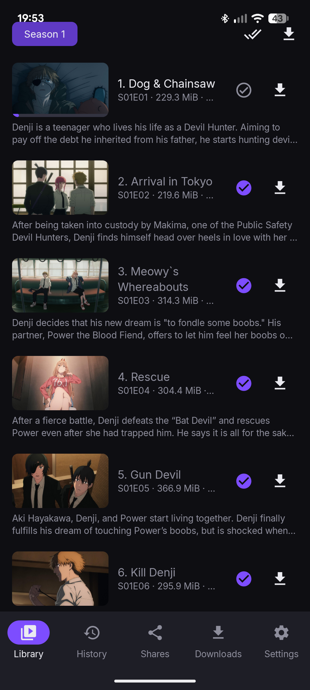

# Android and iOS

The Android and iOS apps share the desktop app's engine, so a library, its watch history and its
settings behave the same everywhere. This page covers what is different on a phone, a tablet and
a TV. [Installation](INSTALL.md) explains how to install each one.

<table>
  <tr>
    <td></td>
    <td></td>
    <td></td>
    <td></td>
  </tr>
</table>

## Adding a share

Tap **Add share** on the **Shares** tab, paste the link, and add a custom password if the link has
one. The app checks the link before it saves it.

- **Android:** you can also share a link to the app from your browser or a chat app, or open a
  `drive.proton.me/urls/…` link directly if you allow the app to open supported links in the
  system settings.
- **iOS:** there is no share sheet. Copy the link, then tap **Paste link** in the dialog.

Folders of your own Drive work as on the desktop: sign in on the **Shares** tab, then **Add from
your Drive**. See [Account and sync](ACCOUNT_AND_SYNC.md).

## The player

- Tap to show or hide the controls.
- **Double-tap** the left or right third of the screen to go back or forward 10 seconds. Double-tap
  the middle to pause.
- The menu has **Episodes**, **Chapters**, **Playback speed**, the audio and subtitle tracks, and
  **Lock to landscape**.
- **Skip opening** and **Skip ending** work as on the desktop, AniSkip included: see
  [The player](USER_GUIDE.md#the-player).
- Sound keeps playing with the screen off or the app in the background, with controls on the lock
  screen. Turn off **Background audio** in Settings to stop that.

Picture-in-Picture is not available on either platform.

## Android TV

The app appears in the TV launcher. With the controls hidden:

| Remote | Does |
|---|---|
| Left / right | Back or forward 10 seconds |
| Centre, up or down | Show the controls |
| Play/pause | Pause and play |

There is no separate TV layout yet, and the app has not been tested on a real TV. Reports are
welcome.

## Downloads

Download an episode, a season or a show from its title page, and play it from the **Downloads**
tab without a connection.

- **Android** waits for Wi-Fi unless you turn off **Download on Wi-Fi only**. Downloads continue
  with the app closed.
- **iOS** downloads only while the app is open, and for the short time iOS allows after you leave
  it. A stopped download resumes where it stopped.

**Delete all offline episodes** in Settings frees the space in one step.

## New episodes

When a share gains episodes of a show, the app sends a notification.

- **Android** checks about every 6 hours, when the device has a network and the battery is not
  low. Turn it off with **New episode notifications** in Settings.
- **iOS** asks the system to check every 6 hours or so; iOS decides when it actually runs.

## Where your secrets are kept

- **Android:** in the app's private storage, encrypted with a key in the Android Keystore. If you
  change or remove the device's screen lock, Android may delete that key. The app then asks you
  to **Re-enter link** for each share.
- **iOS:** in the Keychain, only on this device, and not in backups.

## Requirements

- **Android 12** or newer, on an arm64 or x86_64 device. 32-bit devices are not supported.
- **iOS 17** or newer, on iPhone or iPad.
