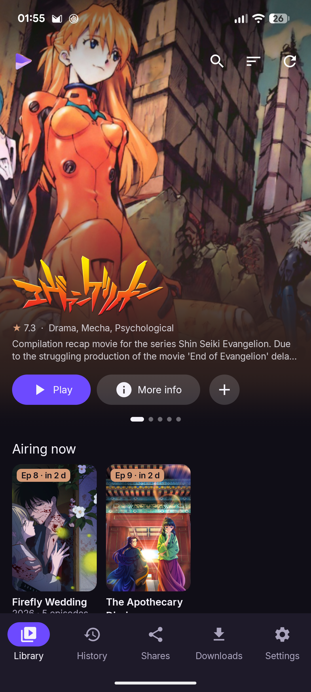
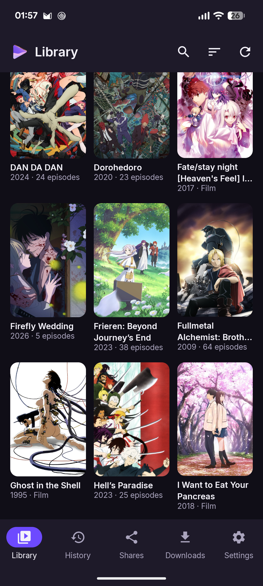
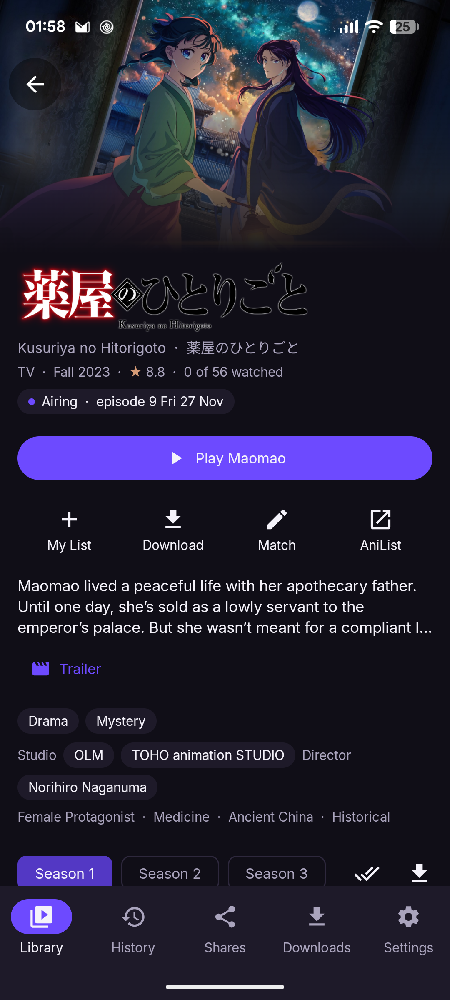
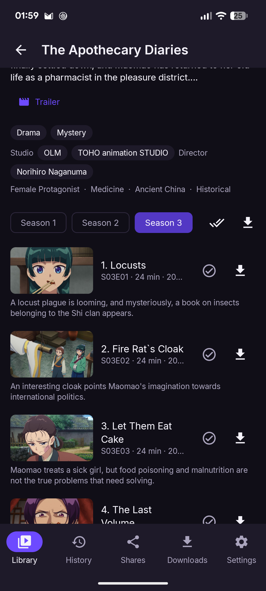
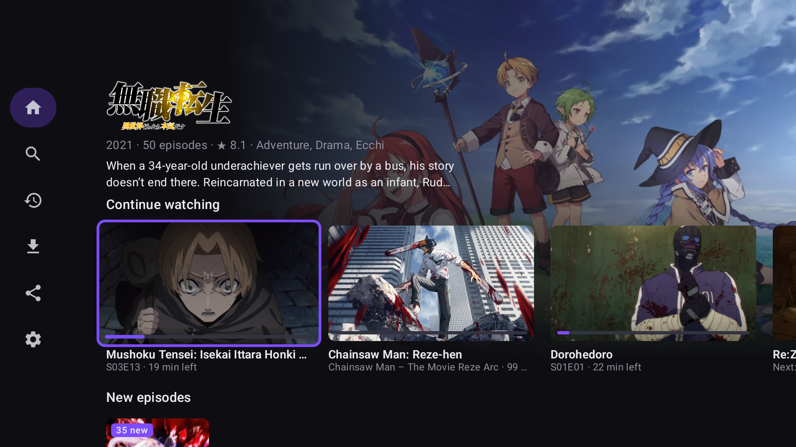
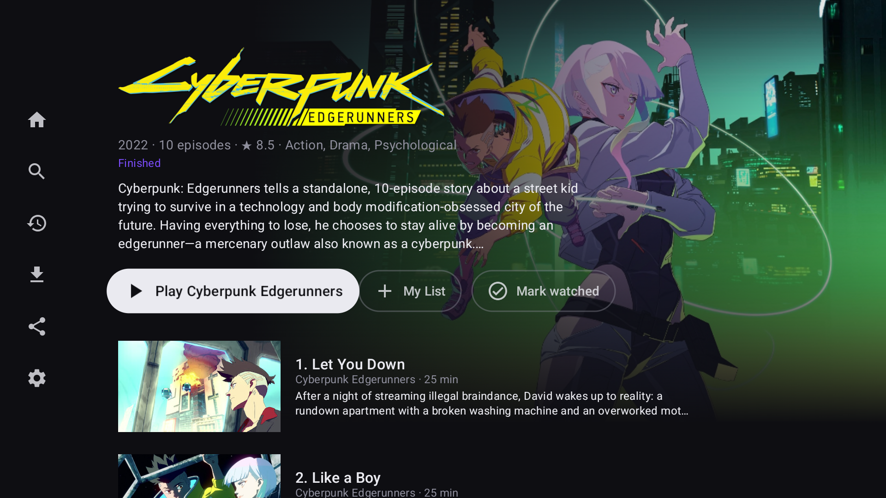
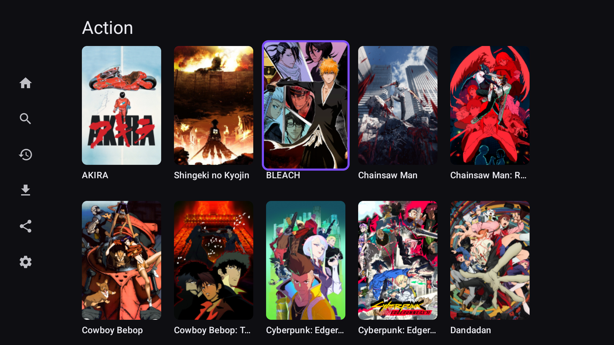

# Android and iOS

The Android and iOS apps share the desktop app's engine, so a library, its watch history and its
settings behave the same everywhere. This page covers what is different on a phone, a tablet and
a TV. [Installation](INSTALL.md) explains how to install each one.

The Android launcher, app settings and share sheet use the full name **Proton Stream**.
Its violet–pink play prism with metallic copper depth belongs to the same icon family as Drive
and Gallery. Android launchers that support themed icons can also display its
monochrome play mark.

<table>
  <tr>
    <td></td>
    <td></td>
    <td></td>
    <td></td>
  </tr>
</table>

## Adding a share

Tap **Add share** on the **Shares** tab, paste the link, and add a custom password if the link has
one. The app checks the link before it saves it.

- **Android:** you can also share a link to the app from your browser or a chat app, or open a
  `drive.proton.me/urls/…` link directly if you allow the app to open supported links in the
  system settings.
- **iOS:** there is no share sheet. Copy the link, then tap **Paste link** in the dialog.

Folders of your own Drive work as on the desktop: sign in on the **Shares** tab, then **Add from
your Drive**. See [Account and sync](ACCOUNT_AND_SYNC.md).

## The player

- Tap to show or hide the controls.
- **Double-tap** the left or right third of the screen to go back or forward 10 seconds. Double-tap
  the middle to pause.
- **Swipe** up and down on the left half for brightness and on the right half for volume. Swipe
  sideways to seek: the bubble shows where you will land, and the seek happens when you let go.
  Swipes that start at the very top or bottom of the screen are left to the system.
- The menu has **Episodes**, **Chapters**, **Playback speed**, the audio and subtitle tracks,
  **Lock to landscape**, **Sleep timer** and **Lock touch**.
- **Sleep timer** pauses after 30 or 60 minutes, or stops at the end of this episode instead of
  going on to the next. It keeps running with the screen off.
- **Lock touch** makes the picture ignore touches, for a phone in a pocket or a child's hands. Tap
  to bring up **Unlock**.
- **Skip opening** and **Skip ending** work as on the desktop, AniSkip included: see
  [The player](USER_GUIDE.md#the-player).
- Sound keeps playing with the screen off or the app in the background, with controls on the lock
  screen. Turn off **Background audio** in Settings to stop that.

Picture-in-Picture is not available on either platform.

## Android TV

The app appears in the TV launcher and has a layout of its own for the TV, made for the remote.

<table>
  <tr>
    <td></td>
    <td></td>
    <td></td>
  </tr>
</table>

- **Home** shows the title you are on at the top, with its picture and synopsis, and rows under
  it: **Continue watching**, then the same rows as on the phone (new episodes, **My List**, what
  was added, and so on), and every title with the same filters as on the phone. The row you are on
  moves up under the top, and the card you are on stays at the left.
- A title's page opens with **Play** (or **Resume**) ready, so **OK** starts it. Move down for the
  seasons and episodes, and for titles like it.
- **Search** has its own place in the menu on the left. **OK** on the field opens the TV's keyboard,
  the microphone beside it listens instead, and **Down** moves on to what was found. The remote's
  **Search** key opens Search listening, from any page.
- **History**, **Downloads**, **Shares** and **Settings** are the same pages as on the phone.
- The **Menu** key, or holding **OK**, opens what a long press opens on a phone, such as
  "Remove from Continue watching" on a card or "Mark watched up to here" on an episode.
- **Back** closes the title page, then returns to Home.

In the player, with the controls hidden:

| Remote | Does |
|---|---|
| Left / right | Back or forward 10 seconds |
| Centre, up or down | Show the controls, with Play focused |
| Back | Hide the controls; again to stop and leave the video |
| Play/pause | Pause and play |
| Rewind / fast-forward | Back or forward 10 seconds |
| Previous / next | Previous or next episode |
| Stop | Stop playback |

When **Skip intro**, **Up next** or the end of an episode appears, **OK** presses its button.

**Continue watching** also appears on the TV's home screen, in its **Play Next** (or **Watch
Next**) row, with how far you got; choosing a card there starts that episode. Removing a card on
the home screen keeps it off until you watch that episode again. **Settings → Playback →
Continue watching on the home screen** turns the row off.

The TV's assistant can search the library too: "search for Frieren on Proton Stream" shows what it
found, and "play Frieren on Proton Stream" plays the title with that name from where you are, or
shows the search when no single title has that name.

Typing a share link on a remote is slow, so **Add share** on a TV shows a QR code instead:

1. Point your phone's camera at it. A page opens in the phone's browser.
2. Paste the share link there, with its custom password if it has one, and send it.
3. The TV opens the link and adds the share. If the link will not open, the page says why and
   keeps what you pasted, so you can fix it on the phone.

The phone needs nothing installed, only to be on the same network as the TV. The code works for
ten minutes, or until a share is added. **Type it instead** opens the ordinary form.

You can also sign in, so that shares added on your phone arrive through sync, or send the link
from a computer with `adb` ([Android](ANDROID.md#android-tv)).

## Downloads

Download an episode, a season or a show from its title page, and play it from the **Downloads**
tab without a connection.

- **Android** waits for Wi-Fi unless you turn off **Download on Wi-Fi only**. Downloads continue
  with the app closed.
- **iOS** downloads only while the app is open, and for the short time iOS allows after you leave
  it. A stopped download resumes where it stopped.

**Delete all offline episodes** in Settings frees the space in one step.

## New episodes

When a share gains episodes of a show, the app sends a notification.

- **Android** checks about every 6 hours, when the device has a network and the battery is not
  low. Turn it off with **New episode notifications** in Settings.
- **iOS** asks the system to check every 6 hours or so; iOS decides when it actually runs.

## Where your secrets are kept

- **Android:** in the app's private storage, encrypted with a key in the Android Keystore. If you
  change or remove the device's screen lock, Android may delete that key. The app then asks you
  to **Re-enter link** for each share.
- **iOS:** in the Keychain, only on this device, and not in backups.

## Requirements

- **Android 12** or newer, on an arm64 or x86_64 device. 32-bit devices are not supported.
- **iOS 17** or newer, on iPhone or iPad.
