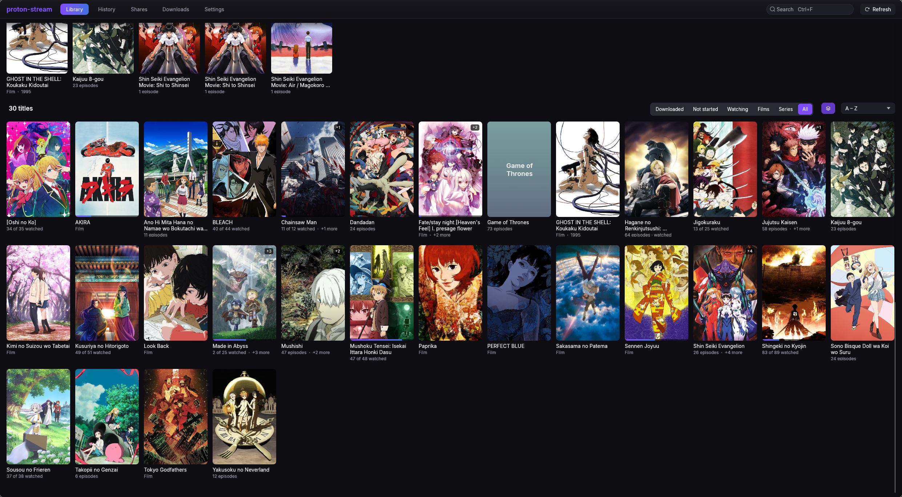

# User guide

This page describes the desktop app. The Android and iOS apps have the same pages as tabs at the
bottom of the screen; [Android and iOS](MOBILE.md) covers what is different there.

The app has five pages, in the bar at the top: **Library**, **History**, **Shares**,
**Downloads** and **Settings**. **Ctrl+1** to **Ctrl+5** open them.

## Library



The library shows every title from every share in one place. Two shares that hold the same show
show it once.

- **The banner** across the top shows the title you watched last first, with **Resume**, how far
  into it you are, **More info** and **My List**. It then turns through up to four more titles that have a wide
  picture, a different set each day, moving on every eight seconds. It holds still while the
  pointer is over it; on a phone, swipe it or tap a dot under it to move on yourself. Its shading
  takes on the colours of the picture behind it, and so does the top of a title's page.
- **Continue watching** has the episode you stopped in for each show, or the next one when you
  finished an episode. To take a show off this row, right-click it and choose **Remove from
  Continue watching**.
- **New episodes** has the shows you are watching that got episodes since you last watched them.
  Their tiles say how many, for example **3 new**.
- **My List** has the titles you put aside to watch, the last one added first.
- **Recently added** has the titles that arrived in the last two weeks and that you have not
  started. Their tiles say **New**. What was already there when you added a share is not new.
- **Shelves** such as **Airing now**, **Directed by Satoshi Kon** or **From MADHOUSE** appear when
  posters and descriptions are on. The app shows at most four, and only for a director, studio or
  genre with at least three titles. On a shelf, a show that is still airing says when its next
  episode is out, for example **Ep 8 · in 2 d**.
- **All titles** is the full grid. Choose a filter and a sort order above it.

Rows that run past the window fade out at the edge. Point at a row to show the arrows at its
ends, which move it along by a page.

| Filters | Sort orders |
|---|---|
| All, My List, Series, Films, Watching, Not started, Downloaded | A – Z, Recently watched, Recently added, Newest, Highest rated, Most popular |

**My List** is a list of titles to watch later. Add a title with **My List** on its page or on
the banner, or right-click its tile and choose **Add to My List**. Choose the button again, or
**Remove from My List**, to take it off. When you are signed in, the list syncs to your other
devices ([Account and sync](ACCOUNT_AND_SYNC.md)).

**Group franchises** folds a series, its sequels and its films into one tile with a **+N** badge.
It is on by default, and needs posters and descriptions to know what belongs together.

**Search** with **Ctrl+F** or **/**. It matches every name a title has: the English one, the
romaji one and the name of its folder.

**Refresh** (or **F5**) reads every share again. The app also does this by itself when a share
has not been read for 6 hours.

### How the library reads your folders

The folder decides which show a file belongs to. The file name gives the season and episode.

| Layout | Read as |
|---|---|
| `Frieren/Season 01/S01E05.mkv` | Frieren, season 1, episode 5 |
| `Frieren/S01E05 - The Hero's Statue.mkv` | The same, with the episode title |
| `Bocchi the Rock/[Group] Bocchi the Rock - 07 [1080p].mkv` | Bocchi the Rock, episode 7 |
| `Spy x Family/Season 2 - 06.mkv` | Spy x Family, season 2, episode 6 |
| `Akira (1988).mkv` | A film, from 1988 |
| `Rebuild of Evangelion/Evangelion - 1.11 You Are (Not) Alone.mkv` and three more | Four films, one title each |

- Season folders can be called `Season 01`, `Season 1`, `S01` or `3rd Season`.
- Folders such as `Specials`, `Extras`, `OVA`, `NCOP` or `Subs` are not taken as a show's name;
  the folder above them is.
- An episode title is read only after a dash, as in `S01E01 - Name`.
- A file with no episode number is a film. A folder of such files, each with a different name, is
  one title per film.

The app plays `mkv`, `mp4`, `m4v`, `avi`, `mov`, `webm`, `ts`, `m2ts` and most other common video
containers.

## A title's page

Click a title to open its page. **Esc** goes back. On a phone, the picture at the top slides
away more slowly than the page, and once it has gone a bar with the title's name stays at the
top.

- **Resume S01E03 · 12:04** continues where you stopped. **Start over** plays the episode from
  the beginning.
- **Download show** keeps every episode on this device. See [Downloads](#downloads).
- **Match…** opens the matcher, where you choose which AniList, TVmaze or TMDB entry the title
  is. Each result names the site it came from. Use it when the app guessed wrong or did not guess
  at all. A match you pick is never replaced.
- **More on AniList** (or TVmaze, or TMDB) opens the title's page there.
- Each season has **Mark season watched** and **Download season**. A show with more than five
  seasons lists them in a drop-down instead of a row of buttons.
- With posters and descriptions on, a chip under the name says where the show stands: **Airing**
  with the day the next episode comes out, **Finished**, **Upcoming**, **On hiatus** or
  **Cancelled**.
- Each episode shows a tick when you have watched it, at the end of its row and in the corner of
  its picture. Right-click an episode and choose **Mark
  watched up to here** to tick it and every episode before it.
- **In this franchise** lists the other parts of the series, when posters and descriptions are on.
- With posters and descriptions on, a show's logo takes the place of its name at the top of the
  page and on the library's banner, and each episode says how long it runs. A film says how long
  it runs in the line under its name.
- A title with no wide picture shows its poster blurred across the top of the page instead, and
  on the library's banner the poster itself beside it.
- Small marks under the name say what most of the files are, when their names say it: **4K**,
  **1080p**, **HDR**, **10-bit** or **Dual audio**.

An episode counts as watched once you have seen 90% of it.

## The player

The picture plays inside the app's window. Move the mouse to show the controls.

- **Skip opening** and **Skip ending** appear when the file's chapters mark an opening, an ending
  or a preview. Files without chapter names get no skip button. Turn on **Skip openings and
  credits** in Settings to skip them without asking.
- **Up next** counts down 10 seconds when the credits start, then plays the next episode. Choose
  **Play now**, **Cancel** or **Watch till the end**.
- **Subtitles and audio** are chosen from the buttons at the bottom right. The app remembers your
  choice for each show. The subtitle menu also has **Size** and **Position**, which are saved like
  the ones in Settings and change styled subtitles only when they are restyled, and **Delay**,
  which moves subtitles earlier or later for this file only.
- **Speed** goes from 0.5× to 3×, and stays for the next episode.

### Keyboard

Press **?** anywhere to see this list in the app.

| Key | Anywhere |
|---|---|
| Ctrl+F or / | Search the library |
| F5 or Ctrl+R | Read every share again |
| Ctrl+1 – 5 | Library, History, Shares, Downloads, Settings |
| Ctrl+, | Settings |
| Ctrl+V | Paste a share link to add it |
| Tab or arrows | Move between titles and episodes |
| Enter | Open or play what is highlighted |
| Alt+← or mouse back | Back |

| Key | Playing |
|---|---|
| Space or K | Pause and play |
| ← / → | Back 10 s, forward 30 s |
| ↑ / ↓ | Volume |
| M | Mute |
| N / P | Next and previous episode |
| [ / ] | Slower and faster |
| S | Skip the opening or the credits |
| Z / X | Subtitles 0.1 s earlier and later |
| E | The list of episodes |
| F or double-click | Fullscreen |
| Ctrl+S | Save the frame to `Pictures/proton-stream` |
| Esc | Leave fullscreen, then the player |

Media keys and your desktop's media controls work too.

### Subtitle files beside the video

The app picks up `.srt`, `.ass`, `.ssa` and `.vtt` files next to a video:

```text
Frieren/Season 01/
  S01E01.mkv
  S01E01.en.srt          English
  S01E01.en.forced.ass   English, "forced"
  Subs/
    S01E01/
      2_English.srt      English
```

A `Subs` folder beside the videos works, and so does any subtitle in a folder that holds a single
video. The language comes from the last word in the name that names one.

### Dialogue, not signs and songs

Many anime releases have two subtitle tracks in one language: the full dialogue, and a short
*Signs & Songs* track that only translates on-screen text. When a file would start on the short
track, the app switches to the full one in the same language.

## History

Everything you played, newest first, grouped by day. An entry says **Watched**, **Stopped at
12:04 of 24:00** or **Played**. Removing an entry marks a watched episode unwatched, or forgets
where you stopped in one you had not finished.

## Downloads

A download keeps a full copy of an episode on this device, to play without a connection. Start
one from a title's page: a whole show, a season or a single episode.

The **Downloads** page lists them with **Pause**, **Resume**, **Cancel**, **Retry**, **Play** and
**Delete**. Three run at a time. Downloads do not count against the streaming cache.

## Shares

The **Shares** page lists every share, with what it holds and when it was last read.

- **Crawl** reads the share again.
- **Rename** changes the name shown in the app.
- **Re-enter link** gives the app the link again, for a keyring that lost it or a password that
  changed. The library, history and downloads stay.
- **Remove** takes the share's titles out of the library, deletes its downloads and removes its
  link and password from the keyring.

The **Proton account** section on this page is where you sign in. See
[Account and sync](ACCOUNT_AND_SYNC.md).

## Settings

**Appearance**

- **Palette:** Proton (the near-black default), Catppuccin Latte, Frappé, Macchiato and Mocha, or
  Persona 5.
- **Accent:** Mauve, Pink, Sky, Pink → Sky, Lavender, Blue, Teal, Peach or Red. **Gradient
  accent** draws it as a gradient.
- **Text size:** 90% to 150%. This one stays on this computer.
- **Library tiles:** posters or stills. **Title names:** as in the share, English or romaji.

**Playback**

- **Audio language** and **Subtitles:** the language to start in, or the file's own default.
- **Play the next episode** (on by default) and **Skip openings and credits** (off).
- **Hardware decoding** (on). Turn it off if the picture shows green blocks or stays black.

**Subtitles**

How subtitles look. A sample line at the top shows the style on a bright and a dark picture, and
a video that is playing changes at once.

- **Size** and **Position**: how big the line is and how far up the picture it sits.
- **Font**, **Bold** and **Italic**: any font installed on this computer. On Linux the sample
  line shows the font too; on Windows and macOS it is drawn in the app's own font, and only the
  video uses the one you chose.
- **Text colour**, and a **Background** of **Outline** or **Box**, each with its own colour. A
  colour's opacity sets how much of the picture shows through. Choose **Box** if text is hard to
  read on bright scenes.
- **Shadow** and **Blur**.
- **Restyle styled subtitles** (off). Plain subtitles (SRT) always take the whole style. Styled
  subtitles (ASS) keep the look, size and place their makers gave them unless this is on; they
  only move up while the player's controls are showing. Turned on, signs and songs can come out
  wrong.
- **Reset** goes back to the default look.

**Storage**

- **Streaming cache:** 1 to 16 GiB, 4 GiB by default. It keeps the parts of videos you streamed,
  so watching again needs no network. **Clear the streaming cache** empties it.

**Posters and descriptions**

- Off by default. When it is on, the app sends the names of your titles to the provider you pick:
  **AniList** (no key needed) or **TMDB** (needs a free API key). With AniList, a title it does
  not have, such as a live-action show, is looked up on **TVmaze** next, which needs no key
  either. See [Privacy](PRIVACY.md).
- **TMDB API key:** needed for TMDB, optional with AniList. With a key, films and shows that have
  no wide picture or logo get TMDB's, asked for by their TMDB id alone. After saving a key,
  **Match everything again** fetches them for titles already matched.
- **Match the library** looks up new titles now. **Match everything again** looks up every title,
  except those you matched by hand.
